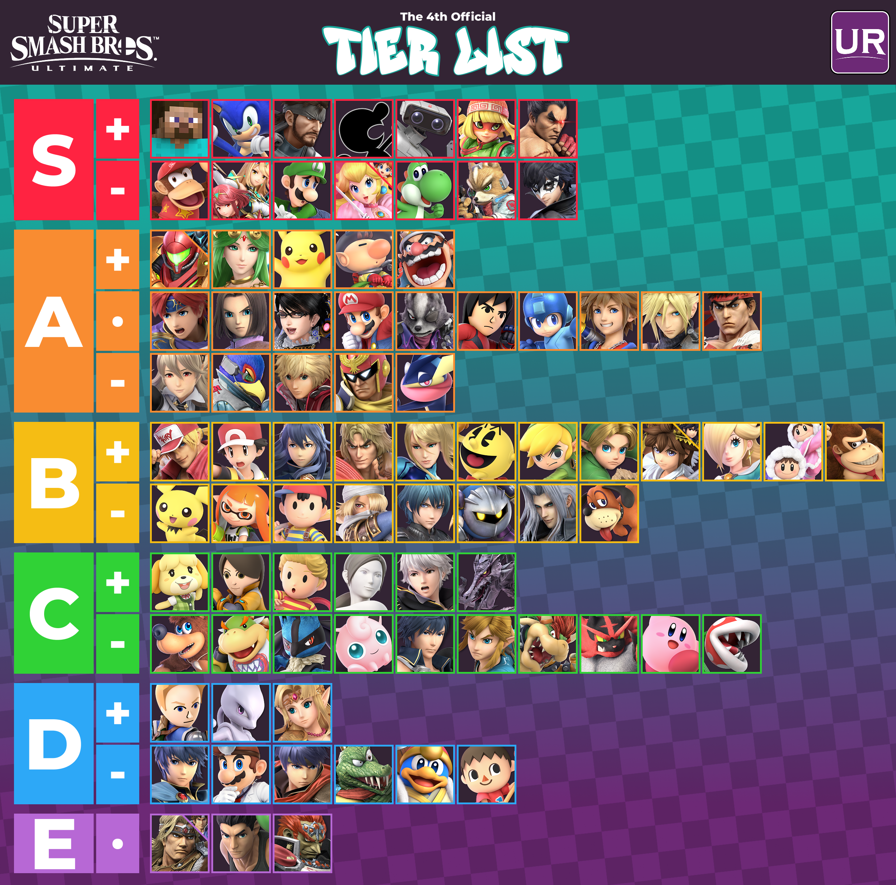
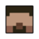
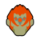

# La Tier-list Super Smash Bros. Ultimate
## Sommaire 

1 - [Origine du jeu](#Origine-du-jeu)  
2 - [Mécaniques expliquées](#Mécaniques-expliquées)  
3 - [Tier-List](#Tier-List)  
4 - [S TIER](#S-TIER)  
5 - [A TIER](#A-TIER)  
6 - [B TIER](#B-TIER)  
7 - [C TIER](#C-TIER)  
8 - [D TIER](#D-TIER)  
9 - [E TIER](#E-TIER)  

## Origine du jeu
[Super Smash Bros Ultimate](https://fr.wikipedia.org/wiki/Super_Smash_Bros._Ultimate) est un jeu développé par nintendo en 2017 et sorti le 7 décembre 2018, un jour que la plupart des fans de nintendos n'oublieront jamais.  
Si ce jeu est aussi populaire, c'est parce que Smash Bros est l'une des franchises de Nintendo les plus connues, car elle regroupe toutes les autres franchises signées Nintendo.  
Le petit dernier se démarque des autres car il est sortie sur la Nintendo Switch, une console plus que connue.  
Il est aussi populaire grâce au fait qu'il n'a pas uniquement ajouté des personnages signés Nintendo, mais aussi des personnages concurrents(Comme Sonic, par exemple, sorti sur Super Smash Bros Brawl, le 3ème jeu de la franchise). Dans ce Repo Git, nous allons analyser plusieurs personnages de différents tiers en les comparant pour bien voir la différence de puissance entre chacuns. La [tier-list](https://medium.com/@ultrankssb/the-fourth-ultrank-tier-list-2026-9c5f6964f7e3) est une tier-list datant de 2026, regroupant tout les personnages du jeu, sans forcément expliquer pourquoi ils sont dans ce tier, et c'est effectivement ce que nous allons voir.    
## Mécaniques expliquées
Avant de commencer, nous allons voir quelques méchaniques à expliquer pour comprendre le wiki :  
|                  Principes                 |                Nom technique utilisé             |
| :----------------------------------------: | :----------------------------------------------: |
|Vie                                         |**Stock**                                         |
|Attaques basiques (A)                       |**Jab**                                           |
|Attaques puissantes (direction + A)         |Up / Side / Down **Tilt**                         |
|Attaques Smash (direction + A en même temps)|**Smash**                                         | 
|Attaques Aériennes (saut + direction + A)   |**Aerials** (ou Neutral/Up/Side/Down air)         |
|Attaques Spéciales (direction + B)          |**Specials** (Neutral / Up / Down B)              |
|Moyens de revenir sur le terrain            |**Recovery**                                      |
|Empêcher de l'adversaire de revenir         |**Edgeguarding**                                  |
|Attraper quelqu'un                          |**Grab** (Forward/Back/Up/Down Throw)             |
|Bouclier                                    |**Shield**                                        |

## Tier-List

## S TIER

### Steve:  
  
Commençons tout d'abord par le personnage le plus fort du jeu, pour d'abord voir à quoi les autres personnages vont se comparer.  
### D'où vient-il ? :
Il vient du célèbre Jeu Vidéo [Minecraft](https://fr.wikipedia.org/wiki/Minecraft), développé pendant les années 2000 et sorti le 18 Novembre 2011. Il était l'un des personnages les plus attendus dans Super  
Smash Bros et c'est uniquement le 14 octobre 2020, qu'il est apparu la première et surement la dernière fois dans un jeu Super Smash Bros.  
### Gameplay :
Le personnage paraît simple à vu d'oeil. Comme dans son jeu d'origine, le personnage peut miner, poser des blocks, taper, sauter... Mais c'est uniquement lorsqu'on joue contre lui qu'on se rend compte qu'il est l'un des persos les plus forts du jeu.  

|         **Points forts**         | **Points faibles** |
| :------------------------------: | :----------------: |
|Specials tous kill confirm        |Un poil lent        |
|Tilt permettant facilement combo  |                    |
|Attaques améliorable              |                    |
|Bonne recovery (Up/side B)        |                    |
|Très bon edgeguard                |                    |
|Smash attaques toutes kill confirm|                    |
|Aerials trop fortes               |                    |
|Trop fort                         |                    |

Entre autre, ce personnage est tellement fort qu'il s'est fait bannir de certains tournois à sa sortie, car même si sa force réside dans ses attaques puissantes et démesurées, son autre force est aussi les bugs de Gameplay, qui l'ont rendu irritable à jouer contre et l'ont rendu aussi puissant. A l'heure qu'il est, ce personnage reste, et restera, l'un des personnages les plus forts de tous les Super Smash Bros. confondus.  

## A TIER

### Bayonetta

### D'où vient-elle ? / Gameplay :    

Ensuite voyons [Bayonetta](https://fr.wikipedia.org/wiki/Bayonetta) , un personnage assez excentrique de l'univers de [Hideki Kamiya](https://fr.wikipedia.org/wiki/Hideki_Kamiya), qui fait son apparition dans le 4ème Opus de la série Super Smash Bros. : dans le classement, elle est placée moins haute que Steve. Pourquoi ? Alors qu'elle a le même potentiel avec des atouts même plus puissant que Steve ? Elle est rapide, elle possède des attaques plus rapides pour démarrer un combo, des mécaniques plus fortes notamment son Down B, qui a la possibilité de ralentir l'adversaire qu'il l'attaque, des Specials qui permettent de démarrer un combo également.. On pourrait croire que c'est injuste de la mettre en-dessous d'un personnage plus lent qu'elle. Mais le problème réside du fait qu'elle a plus de point faible que notre ami Steve.  

|       **Points forts**       |      **Points faibles**    |
| :--------------------------: | :-------------------------:|
|Rapide                        |0 Kill Confirm              |
|Attaques rapides              |Smashs attaques lentes (Lag)|
|Specials initiateur de combo  |Grab faible                 |
|Down B qui peut aider à tuer  |                            |
|Bonne Recovery (Up/Side B)    |                            |
|Triple Jump (Tech. Up B)      |                            |
|Tilt initiateur de combo      |                            |
|Aerials combo extender        |                            |

Comparée à **Steve**, **Bayonetta** n'a que quelques points faibles en plus ce qui l'a rend vulnérable à quelques attaques. Hormis son gros manque de Moves Kill Confirm , ce personnage est assez puissant pour la jouer à un niveau professionnel, en étant à la fois fun à jouer, et impressionant à regarder (Nacer)  

## B TIER

### Samus Sans Armure (Zero Suit Samus)

### D'où elle vient ? / Gameplay :

**Samus Sans Armure** ou **Zero Suit Samus** est le personnage principal de la série [Metroid](https://fr.wikipedia.org/wiki/Metroid) et apparue dans le 3ème Opus de la Série [(Brawl)](https://fr.wikipedia.org/wiki/Super_Smash_Bros._Brawl). Ce personnage est assez spécial car il paraît à vue d'oeil très puissant. Ce qui paraît aussi étonnant, c'est à la fois le fait qu'elle est moins bien classée que nos deux personnages vus précedemments, et que sa version en Armure est aussi mieux classée que celle sans Armure.  
**Zss** (Zero Suit Samus) est un personnage très rapide, et très puissant. Elle possède un combo dévastateur, grâce à son Up Air, avec un finish au Up B pouvant tuer très tôt. Elle possède aussi beaucoup de Lag sur la fin de ses coups, la rendant très vulnérable. Elle est aussi assez prévisible, surtout hors du stage, pour revenir, mais aussi imprévisible par sa rapidité.  

|    **Points forts**   |      **Points faibles**      |
| :-------------------: | :--------------------------: |
|Rapide                 |Beaucoup de Lag               |
|Attaques rapide        |1 Kill confirm régulier (Up B)|
|Combo Puissants        |Prévisible sur sa Recovery    |
|Imprévisible           |Grab lent (mais Puissant)     |
|Redoutable en Edgeguard|                              |
|Excellente Recovery    |                              |

C'est à ce moment précis qu'on se rend compte de la différence entre chaques personnages. En soit, la puissance de chaque perso n'est pas comparable en premier lieu, certains paraîssent fort, tandis que d'autres non, et c'est en fait le plus faible à vue d'oeil qui est le plus fort (A part **Steve** qui est une exception). Zss est un personnage très puissant qui, en 2023, était pratiquement en haut du panier, pour se retrouver en 2026, au milieu du classement. Pourquoi ? C'est en fait à cause de l'irrégularité de certains joueurs professionels en tournoi, qui montrent que **Zss** n'est pas un personnage aussi fort qu'il ne paraît. 

### Donkey Kong  

### D'où il vient ? / Gameplay :

Notre vieil ami **Donkey Kong**, apparu pour la première fois dans son [jeu](https://fr.wikipedia.org/wiki/Donkey_Kong_(jeu_vid%C3%A9o,_1981)) du même nom, est un personnage iconique de la compagnie Nintendo. Il est apparu dans le tout premier Opus [Super Smash Bros.](https://fr.wikipedia.org/wiki/Super_Smash_Bros.) et il est l'une des plus grandes figures de ce jeu.  
Si il est aussi bas dans cette tier-list, c'est à cause de ses désavantages visibles rien qu'en touchant le personnage pour la premère fois. Il est assez lent, il est énorme, il est lourd, il a une mauvaise recovery, il a du lag à chaque smashs attacks... Or, il est placé au même niveau que Zss. Alors pourquoi ? C'est grâce à ses mécaniques très puissantes. Son neutral B permet de charger un coup de poing dévastateur tuant assez rapidement (60%), son side B permet de casser le bouclier ennemi rapidement, mais aussi "***enterrer***" ses ennemis et les bloquer pour tuer facilement. Et le plus important dans son kit, est son plus grand atout. Son forward grab, au lieu d'éjecter l'ennemi, Donkey Kong porte son adversaire et peut se déplacer avec lui sur la carte, avant de le relâcher après quelques secondes. Cette capacité est très puissante car elle permet, en profitant de l'inatention de son adversaire, peut tuer à 0% en l'éjectant hors du stage.

|    **Points forts**    |   **Points faibles**   |
| :--------------------: | :--------------------: |
|Grab                    |Recovery Mauvaise       |
|Portée importante       |Déplacement lent        |
|Beaucoup de Kill confirm|Grosse Hitbox           |
|Coups puissants         |Lags importants         |
|Specials puissants      |Facile à punir          |
|Up B au sol puissant    |Sensible aux projectiles|
|Grande survivabilité    |                        |

**Donkey Kong** a énormément de points faibles comparé à **Zss** et **Steve**, ce qui le rend très vulnérables par rapport aux autres. Or, **Donkey Kong** tape extrêmement fort, et peut facilement dominer le combat grâce a son grab puissant. Lui n'est pas victime d'un mauvais placement à cause de ses résultats en tournoi, mais par son gros désaventage de poids et de taille, qui le rend facile à taper . Il est aussi avantagé par sa portée importante et ses coups puissants permettant de compenser ses points faibles, et c'est bien pour cela qu'il mérite son rang.

## C TIER

### Marie / Isabelle

### D'où elle vient ? / Gameplay :  

**Marie** est un personnage peu remarquable de la série Smash Bros. Sortie dans le dernier opus, et sort tout droit d'un jeu tranquille du nom de [Animal Crossing New Leaf](https://fr.wikipedia.org/wiki/Animal_Crossing:_New_Leaf) .Déjà de un, qu'est ce qu'elle fait dans un jeu comme Smash Bros ? De deux, Ce personnage est tout bonnement basique, avec son forward air jetant un projectile, des tilts assez faibles, et des smashs attaques pouvant tuer à pourcentages très haut, des mécaniques simples comme son side B qui agit comme un deuxième grab, et un Down B très situationnel, qui plante un missile (Gyroïde) dans le sol.Ce personnage est tranquille, à l'image de son jeu d'origine. Elle n'est pas très menaçante, elle est même facile à éjecter, elle n'a pas beaucoup d'avantages, de point forts (à part son Neutral B qui peut stocker un projectile lancé vers toi)..

| **Points forts** | **Points faibles** |
| :--------------: | :----------------: |
|Bonne Recovery    |Lente               |
|Side B à distance |Lags présents       |
|Neutral B         |Légère              |
|Bons combos       |Coups Faibles       |
|                  |0 Kill Confirm      |

**Marie** est effectivement un personnage assez faible, n'ayant que ses combos et ses specials qui peuvent l'aider. Si elle n'avait qu'une seule chose à avoir en plus, ce serait des coups plus puissants, sans ça, elle n'est effectivement pas impressionante et mérite son rang. (C'est l'un des personnages préférés de Lohan donc il faut pas trop la critiquer..). Le personnage est tellement faible comparé à Steve qu'ils ne sont même pas comparables entre eux, c'est vraiment n'importe quoi.

## D TIER
### Mewtwo

### D'où elle vient ? / Gameplay :

**Mewtwo** est un personnage de la série Pokemon, apparu pour la première fois en 1996 dans le jeu [Pokemon Rouge et Bleu](https://fr.wikipedia.org/wiki/Pok%C3%A9mon_Rouge_et_Bleu) en tant que boss ultime. **Mewtwo** est LE pokémon par excellence. Dans son jeu de base, il est très puissant, l'un des meilleurs pokemons de tous les jeux, mais dans Super Smash Bros. ce n'est pas le même personnage. Dès son apparition dans [Super Smash Bros. Melee](https://fr.wikipedia.org/wiki/Super_Smash_Bros._Melee) il était l'un des personnages (si ce n'est) le plus nul du jeu. Pourtant, il a quelques moves intéressant et puissants, notamment son Neutral B mettant la pression à l'adversaire, une mobilité exceptionnel aliée à une bonne recovery, ainsi qu'un Power Kill démesuré. Ses combos sont tout aussi intéressants, pouvant alier à la fois specials et attaques normales. Hormis tous ces points forts, il est désavantagé par son côté ultra léger qui le rend vulnérable à n'importe quelle attaque, une grosse hitbox, qui permet à l'adversaire de combo facilement, et quand il est en situation de désavantage, il est difficile de remonter en stocks, malgré ses attaques puissantes.

| **Points forts**            | **Points faibles**  |
| :--------------:            | :----------------:  |
|Neutral B (Outil de pression)|Ultra léger          |
|Excellente mobilité aérienne |Immense Hitbox       |
|Early Kill Power             |Facile a combo       |
|Excellente recovery          |Désavantage difficile|
|Reflecteur de Projectiles    |                     |

**Mewtwo** est donc dans l'avant dernier tier car il possède beaucoup de moves pouvant mettre une pression à l'adversaire, mais aussi beaucoup de désavantages par sa taille et son poids, ne lui permettant pas d'accéder à un rang au-dessus.

## E TIER

### Ganondorf

### D'où il vient ? / Gameplay :  

**Ganondorf**.. Alias le **PIRE** personnage du jeu. Il vient de la célèbre liscence Zelda, apparu pour la première fois dans [Zelda Ocarina Of Time](https://fr.wikipedia.org/wiki/The_Legend_of_Zelda:_Ocarina_of_Time) , assez imposant par sa carrure, son charisme, sa force... Et bien il n'a malheureusement que ça. Dans Super Smash Bros., il est apparu la première fois sur [Smash Bros Melee](https://fr.wikipedia.org/wiki/Super_Smash_Bros._Melee), et il était assez puissant à l'époque. Malheureusement, même après l'ajout de nouvelles attaques, il fut dépassé par tous les autres personnages de Ultimate. Malgré sa puissance de frappe titanesque, et bien le perso n'a quasiment rien d'autres en point fort. Le personnage est gigantesque, lent sur le sol et lent dans les airs, attaques très lentes, énormément de lags, peu de rangée, très prévisible, Recovery très très nulle, facile à combo...

|         **Points forts**           | **Points faibles** |
| :--------------------------------: | :----------------: |
|Coups très puissants                |Lent                |
|Early Kill Power                    |Facile à combo      |
|Armure sur Neutral B                |Attaques lentes     |
|Bon shield Pressure (Down + Up Tilt)|Lags                |
|Bon Edgeguard (Aerials + Down Tilt) |No range            |
|                                    |Prévisible          |
|                                    |No Recovery         |  
|                                    |Facile à Punir      |
|                                    |Très Nul            |

En bref, **Ganondorf** est très nul, Il n'a rien pour lui, hormis son charisme. Si il n'est pas fort à cause de ses mécaniques, il est néanmoins toujours une menace quand on tombe face à lui, car on se dit "Il peut me tuer facilement" et on essaye de jouer à distance, mais il nous rattrape et point final sur la partie. Quand je dis que les persos ne sont pas comparables, je parle évidemment de **Steve** qui refait son apparition. Si on joue bien un personnage comme **Ganondorf**, on peut se débrouiller et avoir un bon match-up contre la bête de Minecraft et de son kit idiot.

## Sources

Au cas ou ça part en cachouètes, je met les sources :
Super Smash Bros : [https://fr.wikipedia.org/wiki/Super\_Smash\_Bros.](https://fr.wikipedia.org/wiki/Super_Smash_Bros.) 
Super Smash Bros Melee[https://fr.wikipedia.org/wiki/Super\_Smash\_Bros\_Melee](https://fr.wikipedia.org/wiki/Super_Smash_Bros._Melee) 
Super Smash Bros Brawl : [https://fr.wikipedia.org/wiki/Super\_Smash\_Bros.\_Brawl](https://fr.wikipedia.org/wiki/Super_Smash_Bros._Brawl) 
Super Smash Bros 4 : [https://fr.wikipedia.org/wiki/Super\_Smash\_Bros.\_for\_Nintendo\_3DS_/\_for\_Wii\_U](https://fr.wikipedia.org/wiki/Super_Smash_Bros._for_Nintendo_3DS_/_for_Wii_U) 
Super Smash Bros Ultimate  :  [https://fr.wikipedia.org/wiki/Super\_Smash\_Bros.\_Ultimate](https://fr.wikipedia.org/wiki/Super_Smash_Bros._Ultimate) 

Jeux Divers :
Donkey Kong : [https://fr.wikipedia.org/wiki/Donkey\_Kong_(jeu\_vid%C3%A9o,\_1981)](https://fr.wikipedia.org/wiki/Donkey_Kong_(jeu_vid%C3%A9o,_1981))
Metroid :[https://fr.wikipedia.org/wiki/Metroid](https://fr.wikipedia.org/wiki/Metroid)
Pokemon :[https://fr.wikipedia.org/wiki/Pok%C3%A9mon\_Rouge\_et\_Bleu](https://fr.wikipedia.org/wiki/Pok%C3%A9mon_Rouge_et_Bleu)
Bayonetta:[https://fr.wikipedia.org/wiki/Bayonetta](https://fr.wikipedia.org/wiki/Bayonetta)
Minecraft :[https://fr.wikipedia.org/wiki/Minecraft](https://fr.wikipedia.org/wiki/Minecraft)
Zelda OOT :[https://fr.wikipedia.org/wiki/The\_Legend\_of\_Zelda:\_Ocarina\_of\_Time](https://fr.wikipedia.org/wiki/The_Legend_of_Zelda:_Ocarina_of_Time)

Tier-List : [https://medium.com/@ultrankssb/the-fourth-ultrank-tier-list-2026-9c5f6964f7e3](https://medium.com/@ultrankssb/the-fourth-ultrank-tier-list-2026-9c5f6964f7e3)
Personnes : 
Hideki Kamiya : [https://fr.wikipedia.org/wiki/Hideki\_Kamiya](https://fr.wikipedia.org/wiki/Hideki_Kamiya)
